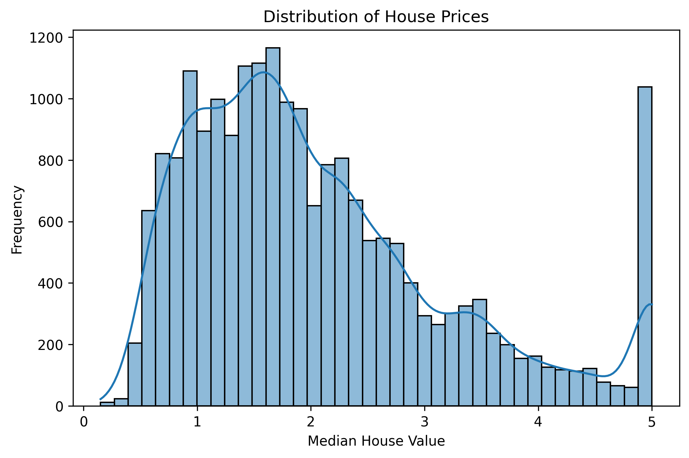
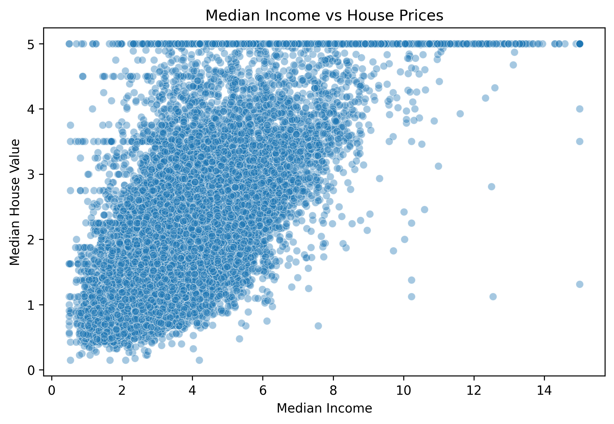
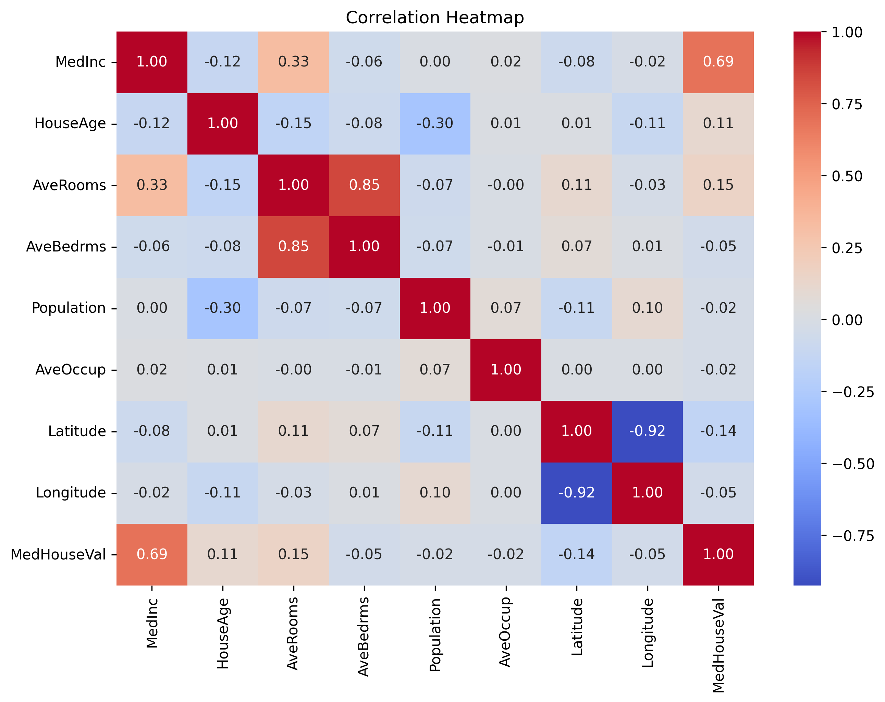
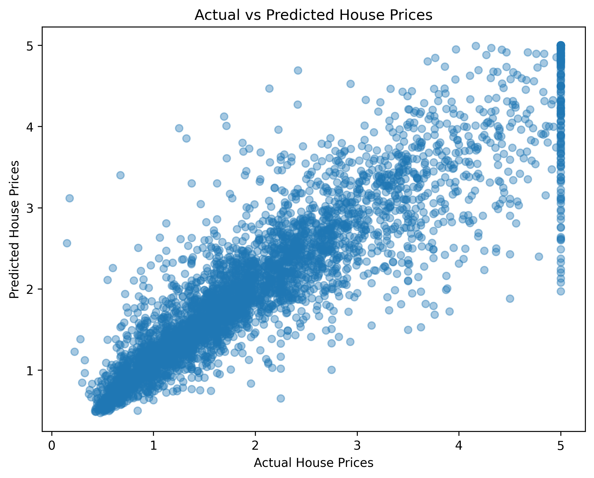
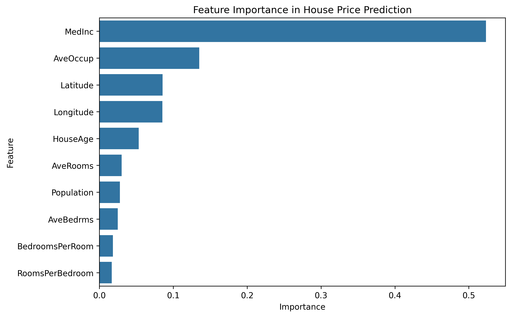

# 🏠 House Price Prediction Using Machine Learning

## 📌 Project Overview

This project focuses on predicting house prices using Machine Learning regression algorithms. It uses the California Housing Dataset to analyse housing-related features and estimate median house values.

The project covers data exploration, preprocessing, feature engineering, model training, evaluation, and prediction.

## 🎯 Project Objectives

- Understand and analyse housing data.
- Perform data cleaning and preprocessing.
- Apply feature engineering techniques.
- Train and compare Machine Learning models.
- Evaluate model performance using regression metrics.
- Predict house prices using a trained model.

## 📊 Dataset Information

**Dataset:** California Housing Dataset  
**Source:** Scikit-learn

| Dataset Details | Information |
|---|---|
| Total Records | 20,640 |
| Original Features | 8 |
| Target Variable | MedHouseVal |
| Problem Type | Regression |
| Training Data | 80% |
| Testing Data | 20% |

### Features Used

- MedInc: Median income
- HouseAge: Median house age
- AveRooms: Average number of rooms
- AveBedrms: Average number of bedrooms
- Population: Population of the area
- AveOccup: Average household occupancy
- Latitude: Geographic latitude
- Longitude: Geographic longitude

Two additional features were created using feature engineering:

- RoomsPerBedroom
- BedroomsPerRoom

## 🛠️ Technologies Used

| Technology | Purpose |
|---|---|
| Python | Programming language |
| Pandas | Data manipulation |
| NumPy | Numerical calculations |
| Matplotlib | Data visualization |
| Seaborn | Statistical visualization |
| Scikit-learn | Machine Learning |
| Joblib | Model saving and loading |
| Google Colab | Development environment |

## ⚙️ Project Workflow

1. Import required libraries.
2. Load the California Housing Dataset.
3. Perform exploratory data analysis.
4. Handle missing values and duplicate records.
5. Perform feature engineering.
6. Split the dataset into training and testing sets.
7. Apply feature scaling.
8. Train Linear Regression model.
9. Train Random Forest Regressor.
10. Train a baseline model.
11. Evaluate and compare model performance.
12. Select the best-performing model.
13. Test the model with new house data.
14. Save and compress the trained model.

## 🤖 Machine Learning Algorithms

### 1. Linear Regression

A supervised learning algorithm used to predict continuous numerical values by identifying relationships between input features and the target variable.

### 2. Random Forest Regression

An ensemble learning algorithm that combines multiple decision trees to improve prediction performance.

The final Random Forest model was configured with:
- Number of trees: 30
- Maximum depth: 15
- Random state: 42

### 3. Baseline Model

A mean-based regression model was used as a reference to compare the performance of the trained models.

## 📈 Model Evaluation

The final Random Forest Regressor achieved the following results on the test dataset:

| Evaluation Metric | Result |
|---|---:|
| R² Score | 0.7968 (79.68%) |
| RMSE | 0.5160 |
| MAE | 0.3392 |

### Performance Analysis

- The model achieved an R² score of approximately 79.68%.
- RMSE measures the prediction error and gives greater weight to larger errors.
- MAE represents the average absolute prediction error.
- The Random Forest model was selected as the final model.

The target variable is measured in units of $100,000. Therefore, the RMSE and MAE values are also expressed in those units.

## 📊 Data Visualizations

### 1. House Price Distribution

Shows the distribution of median house values in the dataset.



### 2. Income vs House Price

Shows the relationship between median income and median house value.



### 3. Correlation Heatmap

Displays the correlation between different housing features.



### 4. Actual vs Predicted House Prices

Compares actual house values with the values predicted by the selected model.



### 5. Feature Importance

Shows the relative contribution of different features to the Random Forest model's predictions.



## 📂 Project Structure

```text
House-Price-Prediction/
│
├── Task_3_House_Price_Prediction.ipynb
├── house_price_prediction_model_compressed (1).pkl
├── house_price_distribution.png
├── income_vs_house_price.png
├── correlation_heatmap.png
├── actual_vs_predicted.png
├── feature_importance.png
└── README.md
```

## 💡 Key Learnings

Through this project, I gained practical experience in:

- Understanding supervised Machine Learning.
- Working with real-world datasets.
- Data cleaning and preprocessing.
- Feature engineering techniques.
- Training regression algorithms.
- Evaluating model performance.
- Visualizing data and prediction results.
- Saving and reusing trained Machine Learning models.

## ⚠️ Limitations

The California Housing Dataset contains median house values measured in units of $100,000. The target values are capped at 5.0, so the model may not accurately represent higher-value properties.

The predictions are intended for educational purposes and should not be treated as actual current property market valuations.

## 👩‍💻 Author

**Aayusha Jagtap**

GitHub: [aayusha-j](https://github.com/aayusha-j)

**Project:** CodeNova AI/ML Internship Program

---

⭐ If you find this project useful, feel free to explore the repository!
